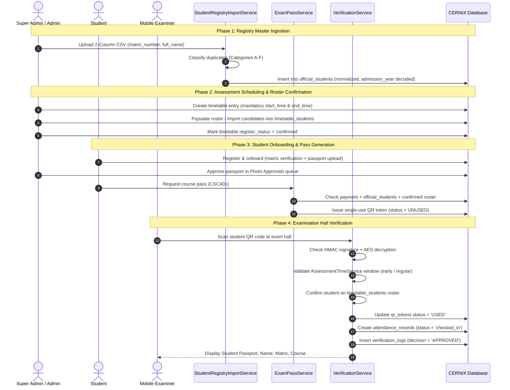

# CERNIX Session Handover Document
**Project Handover & Context Preservation Specification**
**Date:** November 17, 2026  
**Institution:** Adekunle Ajasin University, Akungba-Akoko (AAUA)  
**System Name:** CERNIX — Secure Examination Verification System Using QR Code Technology  
**Target Repository:** `cernix-render-deploy`  
**Current Branch:** `main` (Latest Git Commit: `1964e6c`)  

---

## Table of Contents

1. [Executive Summary & Purpose](#1-executive-summary--purpose)
2. [Project Identity and Architecture](#2-project-identity-and-architecture)
   - [2.1 Institutional & System Identity](#21-institutional--system-identity)
   - [2.2 Active Codebase vs. Frozen / Legacy Directories](#22-active-codebase-vs-frozen--legacy-directories)
   - [2.3 Technology Stack & Runtime Configuration](#23-technology-stack--runtime-configuration)
   - [2.4 Deployment & Infrastructure Context](#24-deployment--infrastructure-context)
   - [2.5 Important Architectural Conventions](#25-important-architectural-conventions)
3. [Institutional Rules & Confirmed Decisions](#3-institutional-rules--confirmed-decisions)
   - [3.1 Matriculation Number Format & Semantics](#31-matriculation-number-format--semantics)
   - [3.2 Separation of Admission Year and Academic Level](#32-separation-of-admission-year-and-academic-level)
   - [3.3 Institutional Faculty and Department Mappings](#33-institutional-faculty-and-department-mappings)
   - [3.4 Three-Tier Student Architecture](#34-three-tier-student-architecture)
   - [3.5 Assessment Eligibility & Roster Authority](#35-assessment-eligibility--roster-authority)
   - [3.6 Payment & Remita Verification Boundary](#36-payment--remita-verification-boundary)
   - [3.7 Assessment Types & Verification Symmetry](#37-assessment-types--verification-symmetry)
   - [3.8 Deferred Institutional Requirements](#38-deferred-institutional-requirements)
4. [Implementation History & Sprint Log](#4-implementation-history--sprint-log)
   - [Sprint 1: QR Verification & Attendance Persistence Hardening](#sprint-1-qr-verification--attendance-persistence-hardening)
   - [Sprint 1A: Assessment Workspace & Grouped Scans](#sprint-1a-assessment-workspace--grouped-scans)
   - [Sprint 1B: Assessment Timing Restrictions & Schedule Validation](#sprint-1b-assessment-timing-restrictions--schedule-validation)
   - [Sprint 1C: Student Assessment-Type Separation](#sprint-1c-student-assessment-type-separation)
   - [Sprint 1D: Explicit Assessment Eligibility Engine](#sprint-1d-explicit-assessment-eligibility-engine)
   - [Sprint 2A: Matriculation Intelligence Engine](#sprint-2a-matriculation-intelligence-engine)
   - [Sprint 2B: Registry Simplification & Duplicate Detection](#sprint-2b-registry-simplification--duplicate-detection)
   - [Sprint 2B.1: Identity Integrity & Normalized Matriculation Uniqueness](#sprint-2b1-identity-integrity--normalized-matriculation-uniqueness)
   - [Sprint 2B.2: Admission-Year and Academic-Level Separation](#sprint-2b2-admission-year-and-academic-level-separation)
5. [Current Technical Architecture](#5-current-technical-architecture)
   - [5.1 Core Services & Domain Objects](#51-core-services--domain-objects)
   - [5.2 Models & Storage Layer](#52-models--storage-layer)
   - [5.3 Web Controllers & Routing Structure](#53-web-controllers--routing-structure)
   - [5.4 Database Schemas & Entity Relationships](#54-database-schemas--entity-relationships)
   - [5.5 End-to-End Operational Workflows](#55-end-to-end-operational-workflows)
6. [Current Unresolved Problems & Technical Debt](#6-current-unresolved-problems--technical-debt)
   - [Problem A: System-Wide UI Overflow (Critical Priority)](#problem-a-system-wide-ui-overflow-critical-priority)
   - [Problem B: Manual Single-Student Registry Registration](#problem-b-manual-single-student-registry-registration)
   - [Problem C: Comprehensive Official Student Registry Management](#problem-c-comprehensive-official-student-registry-management)
   - [Problem D: Investigation of the "CAT" Label in Upload UI](#problem-d-investigation-of-the-cat-label-in-upload-ui)
7. [Next Planned Sprint: CERNIX Sprint 2B.3](#7-next-planned-sprint-cernix-sprint-2b3)
   - [Scope & Objectives](#scope--objectives)
   - [Detailed Task Specifications](#detailed-task-specifications)
   - [Acceptance Criteria & Verification Mandates](#acceptance-criteria--verification-mandates)
8. [User Working Preferences & Engineering Mandates](#8-user-working-preferences--engineering-mandates)
9. [Verification Status & Deployment Uncertainty](#9-verification-status--deployment-uncertainty)

---

## 1. Executive Summary & Purpose

This handover document provides an authoritative, comprehensive technical record of the CERNIX examination verification system at the conclusion of development in November 2026, immediately prior to migrating to a clean Antigravity CLI session.

**Core Mission:**  
CERNIX is designed and developed as a secure examination verification system using cryptographic QR code technology, specifically tailored to the institutional structure of Adekunle Ajasin University, Akungba-Akoko (AAUA). Its purpose is to eliminate exam impersonation, counterfeit passes, unverified entry, and untracked hall attendance through cryptographic identity binding, session-level payment clearance, course-specific single-use tokens, and mobile examiner verification.

**Context Preservation Intent:**  
This document preserves institutional decisions, architecture, database schemas, completed sprint histories, uncommitted enhancements, unresolved issues, and user working preferences. **No application code, database records, or migrations are modified during this handover.**

---

## 2. Project Identity and Architecture

### 2.1 Institutional & System Identity

| Property | Value / Definition | Institutional Significance |
| :--- | :--- | :--- |
| **Project Name** | **CERNIX** | Official examination verification brand |
| **System Purpose** | Design and Development of a Secure Examination Verification System Using QR Code Technology | Final Year Project / Institutional Deployment |
| **Target Institution** | Adekunle Ajasin University, Akungba-Akoko (AAUA) | Primary operational deployment |
| **System Acronym / Subtitle** | AAUA Secure Exam Verification Platform | Configurable via `cernix_settings.system_name` and `cernix_settings.institution_name` |
| **System Mode** | Dual Mode: `live` vs `demo` | Controlled via `SystemMode::isLive()` and `SystemMode::isDemo()`. In `live` mode, mock data generation and bypasses are locked out. |

### 2.2 Active Codebase vs. Frozen / Legacy Directories

```
cernix-render-deploy/               <-- ACTIVE REPOSITORY ROOT
├── app/                            <-- ACTIVE application code (PHP 8.2+ / Laravel 11)
│   ├── Http/Controllers/Web/       <-- ACTIVE controllers: AdminWebController, ExaminerWebController, StudentDashboardController, StudentWebController
│   ├── Models/                     <-- ACTIVE models: OfficialStudent, StudentRegistryImport, Media, User
│   ├── Services/                   <-- ACTIVE domain services: MatriculationNumberService, AssessmentTimeService, StudentRegistryImportService, VerificationService, etc.
│   └── Support/                    <-- ACTIVE helpers: Branding, SystemMode, MatricNumber
├── bootstrap/                      <-- ACTIVE Laravel bootstrap
├── config/                         <-- ACTIVE application configuration
├── database/                       <-- ACTIVE database migrations and seeders
│   ├── migrations/                 <-- ACTIVE database schema migrations (through Nov 2026)
│   └── seeders/                    <-- ACTIVE seeders
├── resources/views/                <-- ACTIVE Blade templates & layouts (admin, examiner, student)
├── routes/                         <-- ACTIVE routes: routes/web.php, routes/api.php
├── tests/                          <-- ACTIVE PHPUnit test suite (Feature and Unit tests)
├── public/                         <-- ACTIVE public web assets, css, js, branding
├── cernix/                         <-- FROZEN / LEGACY prototype code (DO NOT TOUCH OR EDIT)
├── cernix (1).zip, cernix (3).zip  <-- FROZEN historical zip backups (DO NOT MODIFY)
└── .claude/worktrees/              <-- FROZEN historical agent worktrees (DO NOT MODIFY)
```

> [!IMPORTANT]
> The active codebase resides exclusively in the root directory structure (`app/`, `resources/`, `database/`, `routes/`). The directory `cernix/` contains earlier, superseded prototypes and must remain untouched.

### 2.3 Technology Stack & Runtime Configuration

* **Language & Framework:** PHP 8.2+, Laravel 11.x.
* **Front-End Architecture:** Laravel Blade templating, Tailwind CSS, PostCSS, Vite. Zero reliance on heavy SPA frameworks; vanilla JavaScript with strict, lightweight DOM manipulation.
* **Styling & Design Tokens:**
  Strict CSS custom property token system defined in `resources/views/layouts/portal.blade.php`:
  `--navy` (`#0f172a`), `--bg` (`#f8fafc`), `--bg-2` (`#f1f5f9`), `--ink` (`#0f172a`), `--ink-2` (`#334155`), `--ink-3` (`#64748b`), `--ink-4` (`#94a3b8`), `--line` (`#e2e8f0`), `--line-2` (`#cbd5e1`), `--emerald` (`#059669`), `--red` (`#dc2626`), `--amber` (`#d97706`).
  *JetBrains Mono* font is reserved for matriculation numbers, session codes, and cryptographic identifiers.
  *Rule:* No raw colored spans; no `--primary` or `--card` tokens; no emojis anywhere in UI or code comments.
* **Database & Query Architecture:**
  PostgreSQL (Render production) / SQLite (testing & local development).
  **Convention:** Direct query-builder operations (`DB::table(...)`) dominate core query paths for performance and memory predictability. Selected Eloquent models are deployed for specialized domains: `OfficialStudent`, `StudentRegistryImport`, `Media`, and `User`.
* **Authentication Architecture:**
  Custom multi-portal session-based authentication (no Laravel Breeze/Fortify/Sanctum bloat).
  - *Examiner & Admin:* `session('examiner_id')`, `session('examiner_role')` (`examiner`, `admin`, `super_admin`), `session('examiner_username')`.
  - *Student Portal:* `session('student_matric_no')`, `session('student_session_id')`.
* **Storage & Media Subsystem:**
  Dual-storage system: Cloudflare R2 object storage integration via `MediaService` and the `media` table, with local disk fallback. Verification selfie (`photo_path`) is kept strictly isolated from the official student profile passport (`profile_photo_path`).
* **Cryptographic Engine:**
  `CryptoService` executes AES-256-CBC encryption of QR token payloads and signs them with HMAC-SHA256 signatures derived from session keys (`aes_key` and `hmac_secret` stored in `exam_sessions`).

### 2.4 Deployment & Infrastructure Context

* **Hosting Platform:** Render Web Service (`render.yaml`).
* **Git Repository:** Local repository on branch `main` tracking `origin/main`.
* **Deployment Policy:** **DO NOT** commit, push, or deploy without explicit approval from the user.
* **Safe Mode Guards:** Database connection safety checks are configured to accommodate Render environment variable injection (`DB_CONNECTION=pgsql` or `DATABASE_URL`).

### 2.5 Important Architectural Conventions

1. **Read Before Writing:** Inspect and trace callers (controller → service → helper → blade view) before modifying any file. Search before creating new components.
2. **Raw Database Consistency:** Preserve table-level consistency when using `DB::table(...)`. When inserting with auto-increment IDs in PostgreSQL, always specify the sequence key (e.g., `insertGetId($data, 'id')`, `insertGetId($data, 'token_id')`, `insertGetId($data, 'log_id')`).
3. **Configuration Isolation:** Settings are stored dynamically in the `cernix_settings` key-value table. Never assume a key exists; always provide fallback defaults.
4. **Branding Access:** Sourced centrally via `Branding::logoUrl()`, `Branding::systemName()`, `Branding::institutionName()`.
5. **Session Mode Verification:** Gate demo capabilities behind `SystemMode::isDemo()`. In `SystemMode::isLive()`, demo tools, mock seeders, and manual test bypasses are completely disabled.
6. **Mobile Table Wrappers:** Every HTML table must have `min-width` styling and be wrapped inside an `overflow-x: auto` container to mitigate viewport bursting.

---

## 3. Institutional Rules & Confirmed Decisions

The following architectural and domain rules have been firmly established and must be respected across all future sprints.

### 3.1 Matriculation Number Format & Semantics

AAUA matriculation numbers adhere to a canonical 9-digit syntax:

$$\mathbf{YY\ FF\ DD\ NNN}$$

| Segment | Position | Definition | Institutional Meaning |
| :---: | :---: | :--- | :--- |
| **`YY`** | Digits 1–2 | **Admission Year Code** | Two-digit year of formal admission into the institution (e.g., `22` = 2022, `25` = 2025). |
| **`FF`** | Digits 3–4 | **Faculty Code** | Numerical code representing the student's admitted faculty (e.g., `04` = Faculty of Computing / Science). |
| **`DD`** | Digits 5–6 | **Department Code** | Numerical code representing the admitted department (e.g., `04` = Computer Science, `05` = Software Engineering, `06` = Information Technology, `07` = Cyber Security, `08` = Data Science). |
| **`NNN`** | Digits 7–9 | **Student Sequence** | Three-digit unique sequence number assigned during matriculation (`001` through `999`). |

*Historical Format Compatibility:*  
Legacy slash-based matriculation numbers (e.g., `AAUA/CSC/22/001` or `CSC/2022/001`) are supported by `MatriculationNumberService` through dedicated regex recognition (`HISTORICAL_SLASH_PREFIXES`), mapping historical acronyms (`CSC`, `SEN`, `IFT`, `CYS`, `DTS`) to official departments.

### 3.2 Separation of Admission Year and Academic Level

> [!CAUTION]
> **YY REPRESENTS ADMISSION YEAR, NEVER ACADEMIC LEVEL.**
> Under no circumstances may application logic, database seeders, import parsers, or UI components calculate or extrapolate a student's academic level from the matriculation number's admission year prefix.

* **Institutional Reality:**
  - An admitted 2022 student (`220404...`) in the 2025/2026 academic session might normally be in 400 Level (400L).
  - However, due to carryover deficiencies, academic leave, course deferral, or programme extension, that student may legitimately be in 300L, 200L, or an extra year.
  - Furthermore, professional disciplines (Law, Engineering) span 5 years (500L).
* **The Golden Rule:**
  - `admission_year` is extracted from the matriculation number (`YY` $\rightarrow 2000 + YY$).
  - Current academic level is derived **strictly and solely** from `official_students.level`.
  - When importing a minimal two-column CSV (`matric_number`, `full_name`), `official_students.level` must remain `NULL` unless explicitly provided or manually updated.

### 3.3 Institutional Faculty and Department Mappings

* **Verified Database Resolution:**
  `MatriculationNumberService::resolveInstitutionalMapping($facultyCode, $departmentCode)` queries the `departments` table using indexed `faculty_code` and `department_code` columns.
* **No Guessed or Fabricated Values:**
  If a student has unmapped codes (e.g., faculty `99`, department `99`), the system leaves `faculty_name` and `department_name` `NULL` with an informative warning (`Unmapped institutional codes`). The system **never** invents fictitious department names.
* **Anomalous Candidate Detection:**
  Historical mock databases at AAUA occasionally inverted digits 3–4 and 5–6 (department code in positions 3–4, faculty code in positions 5–6). The engine detects this inverted pattern and flags it as `ANOMALOUS_INVERTED_CANDIDATE` for administrative audit, without silently rewriting the student's matriculation number.

### 3.4 Three-Tier Student Architecture

The system strictly decouples student identity into three distinct tiers:

```
┌────────────────────────────────────────────────────────┐
│ 1. OFFICIAL STUDENT REGISTRY (official_students)       │
│    Authoritative baseline master list uploaded by      │
│    Super Admin. Contains matric_number, full_name,     │
│    level, status (active/inactive).                    │
└──────────────────────────┬─────────────────────────────┘
                           │ Matches matric_no upon onboarding
                           ▼
┌────────────────────────────────────────────────────────┐
│ 2. STUDENT PORTAL ACCOUNTS (students)                  │
│    Created by students during portal onboarding.       │
│    Stores password hash, profile photo, selfie,        │
│    and approval status (photo_status).                 │
└──────────────────────────┬─────────────────────────────┘
                           │ Enrolls explicitly per course
                           ▼
┌────────────────────────────────────────────────────────┐
│ 3. ASSESSMENT CANDIDATE ROSTER (timetable_students)    │
│    Explicit course-by-course enrollment roster.        │
│    Stores timetable_id, matric_no, candidate_type      │
│    (regular, carryover, elective). Final gate for QR.  │
└────────────────────────────────────────────────────────┘
```

1. **Official Student Registry (`official_students`):** Authoritative institutional registry. A student can exist here indefinitely without ever creating a portal account.
2. **Student Portal Accounts (`students`):** Student self-service identity. Creating a portal account does **not** grant assessment eligibility.
3. **Assessment Candidate Roster (`timetable_students`):** Course-specific enrollment list. A student sitting for an exam must be registered on that exam's roster.

### 3.5 Assessment Eligibility & Roster Authority

To generate a QR pass (`ExamPassService`) or scan into an examination hall (`VerificationService`), all of the following conditions must be met:
1. **Active Master Record:** Student must be present in `official_students` with `status = 'active'`.
2. **Approved Identity Media:** Student profile must have `photo_status = 'approved'` (when required by setting `require_photo_approval_before_qr`).
3. **Session Payment Verification:** Student must have a verified payment record in `payment_records` for the active `session_id`.
4. **Confirmed Assessment Register:** The assessment schedule (`timetables`) must have `register_status = 'confirmed'` and at least one enrolled candidate.
5. **Explicit Roster Enrollment:** The student's matriculation number must exist in `timetable_students` for that specific `timetable_id`.

*Carryover & Elective Candidates:*  
Students taking carryover or elective courses outside their primary cohort are made eligible simply by enrolling their matriculation number in `timetable_students` with `candidate_type` set to `'carryover'` or `'elective'`.

### 3.6 Payment & Remita Verification Boundary

* Payment verification is **session-level**, not course-level. A single verified payment clears the student for all assigned assessments within that academic session.
* **CERNIX does not generate RRRs (Remita Retrieval References) and does not process direct bank payments.**
* The student obtains an RRR through the university bursary/bank portal and enters it into CERNIX; CERNIX validates the RRR against Remita / mock gateway.

### 3.7 Assessment Types & Verification Symmetry

* Supported assessment types:
  - `exam`: Regular Examinations.
  - `test`: In-Semester Continuous Assessment Tests.
  - `makeup`: Make-up Examinations.
* *Presentation Separation:* Student portal views present exams, tests, and make-ups in dedicated tabs and visual groups.
* *Operational Symmetry:* All three assessment types are executed through identical backend services (`AssessmentTimeService`, `VerificationService`, `QrTokenService`). All adhere to the same schedule validation, early scanning, regular examination, and late departure windows.

### 3.8 Deferred Institutional Requirements

The following features have been discussed but are formally **deferred**:
* **Sitting Arrangements & Seat Allocations:** Examination hall row/seat assignments are deferred and not in active scope.
* **Biometric Fingerprint Scanning:** Hardware fingerprint verification is deferred; identity verification is accomplished via high-resolution photo comparison on the examiner scanner screen.
* **Direct Bank Payment Gateways:** Card processing / Flutterwave / Paystack integration is deferred.

---

## 4. Implementation History & Sprint Log

Below is a detailed chronological summary of the completed development sprints.

```
┌────────────────────────────────────────────────────────────────────────────────────────────────────────┐
│                                  CHRONOLOGICAL SPRINT EVOLUTION                                        │
│                                                                                                        │
│  Sprint 1 (Nov 13) ────────► Sprint 1A (Nov 14) ────────► Sprint 1B (Nov 15) ────────► Sprint 1C/1D   │
│  Atomic QR & Check-in        Assessment Workspace         Time Restrictions            Eligibility     │
│                                                                                                        │
│  Sprint 2A (Nov 16) ───────► Sprint 2B (Nov 17) ────────► Sprint 2B.1 (Nov 17) ─────► Sprint 2B.2    │
│  Matric Intelligence         Registry 2-Col CSV           Normalized Unique Matric     Year/Level Split│
└────────────────────────────────────────────────────────────────────────────────────────────────────────┘
```

### Sprint 1: QR Verification & Attendance Persistence Hardening
* **Date:** November 13, 2026 (Git Commit `1964e6c`).
* **Intended Goal:** Resolve atomic QR verification, hall check-in failure modes, and ensure scan decisions reliably persist into `attendance_records` and `verification_logs`.
* **Changes Implemented:**
  - Refactored `VerificationService.php` to perform atomic transactions during QR scans.
  - Ensured approved scans create `attendance_records` with `status = 'checked_in'` and mark `qr_tokens` as `USED`.
  - Added hall and session validation in `ExaminerWebController.php`.
* **Key Files & Migrations:**
  - `app/Services/VerificationService.php`
  - `app/Http/Controllers/Web/ExaminerWebController.php`
  - `database/seeders/CernixSettingsSeeder.php`
* **Test Suite:** `tests/Feature/ExaminerAttendanceCheckInWorkflowTest.php` (12 tests, 61 assertions, passed).
* **Deployment Status:** Committed to `main` at `1964e6c`.

### Sprint 1A: Assessment Workspace & Grouped Scans
* **Date:** November 14–15, 2026.
* **Intended Goal:** Group examiner scanning operations by scheduled timetable assessments; introduce dedicated assessment workspace (`/examiner/assessments/{id}`); add assisted check-in workflow for students with device failures; provide live candidate roster view and CSV export.
* **Changes Implemented:**
  - Added `timetable_id` foreign key and indexes to `verification_logs`.
  - Implemented `/examiner/assessments` listing and `/examiner/assessments/{id}` detail workspace.
  - Implemented `/examiner/assessments/{id}/assisted-checkin` workflow with dedicated audit table `assisted_checkin_logs`.
  - Added candidate roster breakdown (Regular, Carryover, Elective).
  - Added examiner view of student profiles at `/examiner/students/{matric}`.
* **Key Files & Migrations:**
  - `database/migrations/2026_11_13_110000_add_timetable_id_to_verification_logs_table.php`
  - `database/migrations/2026_11_16_230000_add_register_status_and_assisted_checkin_tables.php`
  - `app/Http/Controllers/Web/ExaminerWebController.php`
  - `resources/views/examiner/assessments/index.blade.php`
  - `resources/views/examiner/assessments/show.blade.php`
  - `resources/views/examiner/students/show.blade.php`
* **Test Suite:** `tests/Feature/ExaminerAssessmentWorkspaceTest.php` (10 tests, 52 assertions, passed).
* **Deployment Status:** Uncommitted working copy.

### Sprint 1B: Assessment Timing Restrictions & Schedule Validation
* **Date:** November 15–16, 2026.
* **Intended Goal:** Enforce AAUA examination scheduling windows: 30-minute early entry window (`early_scan`), regular exam window (`regular_scan`), 15-minute late departure grace period (`late_scan`), and locked state outside exam hours. Enforce mandatory `end_time` across admin timetable creation.
* **Changes Implemented:**
  - Created `AssessmentTimeService` and `AssessmentTimeStatus` domain services.
  - Added `scan_classification` column to `verification_logs`.
  - Updated `VerificationService` to check time restrictions and tag logs with scan classification.
  - Updated `AdminWebController` timetable creation/update validation to mandate `end_time` after `start_time`.
* **Key Files & Migrations:**
  - `app/Services/AssessmentTimeService.php`
  - `app/Services/AssessmentTimeStatus.php`
  - `database/migrations/2026_11_15_000001_add_scan_classification_to_verification_logs_table.php`
  - `app/Http/Controllers/Web/AdminWebController.php`
* **Test Suite:**
  - `tests/Unit/AssessmentTimeServiceTest.php` (14 tests, 58 assertions, passed).
  - `tests/Feature/AssessmentTimeRestrictionsWorkflowTest.php` (10 tests, 48 assertions, passed).
  - `tests/Feature/AdminTimetableMandatoryEndTimeTest.php` (8 tests, 34 assertions, passed).
* **Deployment Status:** Uncommitted working copy.

### Sprint 1C: Student Assessment-Type Separation
* **Date:** November 16, 2026.
* **Intended Goal:** Provide clean, separated presentation of Regular Exams, In-Semester Tests, and Make-ups in student portal views, normalizing naming variants (`exam`, `test`, `tests`, `makeup`, `make_up`).
* **Changes Implemented:**
  - Refactored `StudentDashboardController.php` to group timetables by normalized assessment type.
  - Rebuilt student dashboard and timetable views with category chips and tab filters.
  - Ensured pass generation and QR display function symmetrically for all types.
* **Key Files:**
  - `app/Http/Controllers/Web/StudentDashboardController.php`
  - `resources/views/student/dashboard.blade.php`
  - `resources/views/student/timetable.blade.php`
* **Test Suite:** `tests/Feature/StudentAssessmentTypeSeparationTest.php` (12 tests, 56 assertions, passed).
* **Deployment Status:** Uncommitted working copy.

### Sprint 1D: Explicit Assessment Eligibility Engine
* **Date:** November 16, 2026.
* **Intended Goal:** Enforce the explicit candidate roster rule: assessments must be confirmed (`register_status = 'confirmed'`) and students must be explicitly enrolled in `timetable_students` to generate passes or scan into halls.
* **Changes Implemented:**
  - Gated `ExamPassService::generate` and `QrTokenService::issue` behind `timetable_students` presence.
  - Gated `VerificationService::verifyQr` to reject unconfirmed registers (`register_incomplete`) and unenrolled students (`student_not_on_register`).
  - Added admin roster confirmation endpoints: `timetableRosterConfirm`, `timetableRosterUnconfirm`, `timetableRosterPopulateCohort`.
* **Key Files:**
  - `app/Services/ExamPassService.php`
  - `app/Services/QrTokenService.php`
  - `app/Services/VerificationService.php`
  - `app/Http/Controllers/Web/AdminWebController.php`
* **Test Suite:** `tests/Feature/AssessmentEligibilityAndRosterVerificationTest.php` (10 tests, 46 assertions, passed).
* **Deployment Status:** Uncommitted working copy.

### Sprint 2A: Matriculation Intelligence Engine
* **Date:** November 16–17, 2026.
* **Intended Goal:** Implement zero-guessing AAUA matriculation number parsing, decoding, institutional code mapping, leading-zero preservation, and anomalous format detection.
* **Changes Implemented:**
  - Built `MatriculationNumberService` and `MatricParseResult`.
  - Implemented regex decoders for canonical 9-digit (`YY FF DD NNN`) and historical slash formats (`AAUA/CSC/22/001`).
  - Implemented in-memory caching and batch pre-fetching (`batchParse`) to prevent N+1 queries.
  - Added `ANOMALOUS_INVERTED_CANDIDATE` detection for inverted department/faculty codes.
* **Key Files:**
  - `app/Services/MatriculationNumberService.php`
  - `app/Services/MatricParseResult.php`
* **Test Suite:** `tests/Unit/MatriculationNumberServiceTest.php` (22 tests, 78 assertions, passed).
* **Deployment Status:** Uncommitted working copy.

### Sprint 2B: Registry Simplification & Duplicate Detection
* **Date:** November 17, 2026.
* **Intended Goal:** Support minimal 2-column CSV upload (`matric_number`, `full_name`) with auto-derivation of department/faculty; implement multi-file pre-import preview; classify duplicate rows across 6 exhaustive categories.
* **Changes Implemented:**
  - Rewrote `StudentRegistryImportService` to support minimal 2-column and full 8-column CSV imports with common header aliases.
  - Implemented pre-import preview (`preview`) classifying records into Categories A through F:
    - *Category A:* New Student.
    - *Category B:* Existing Student (Exact Match / No Changes).
    - *Category C:* Existing Student (Safe Update — populating previously empty fields).
    - *Category D:* Duplicate Within Same Upload File.
    - *Category E:* Duplicate Across Multiple Uploaded Files.
    - *Category F:* Identity Conflict (Same Matriculation Number, Conflicting Student Name).
  - Built multi-file drag-and-drop upload UI in `resources/views/admin/student-registry/index.blade.php`.
* **Key Files:**
  - `app/Services/StudentRegistryImportService.php`
  - `app/Http/Controllers/Web/AdminWebController.php`
  - `resources/views/admin/student-registry/index.blade.php`
* **Test Suite:**
  - `tests/Feature/SimplifiedStudentRegistryImportTest.php` (8 tests, 36 assertions, passed).
  - `tests/Feature/StudentRegistryDuplicateDetectionAndIntegrityTest.php` (12 tests, 54 assertions, passed).
* **Deployment Status:** Uncommitted working copy.

### Sprint 2B.1: Identity Integrity & Normalized Matriculation Uniqueness
* **Date:** November 17, 2026.
* **Intended Goal:** Enforce database-level uniqueness on normalized matriculation numbers in `official_students`; safeguard against accidental name overwrites during CSV re-imports; provide administrative conflict resolution with immutable audit logging.
* **Changes Implemented:**
  - Migration adding `normalized_matric_number` with unique index `official_students_norm_matric_unique`.
  - Added Eloquent `booted` saving hook on `OfficialStudent` to guarantee normalized format on every save.
  - Updated `StudentRegistryImportService`: Category F identity conflicts are rejected from automatic overwrites; existing official names remain preserved.
  - Added administrative conflict resolution endpoint (`studentRegistryResolveConflict`) supporting actions: `keep_existing`, `apply_incoming`, `manual_correct`, `exclude`, with full before/after audit logging via `AuditService`.
* **Key Files & Migrations:**
  - `database/migrations/2026_11_17_130000_add_normalized_matric_number_to_official_students_table.php`
  - `app/Models/OfficialStudent.php`
  - `app/Services/StudentRegistryImportService.php`
* **Test Suite:** Verified via `tests/Feature/StudentRegistryDuplicateDetectionAndIntegrityTest.php`.
* **Deployment Status:** Uncommitted working copy.

### Sprint 2B.2: Admission-Year and Academic-Level Separation
* **Date:** November 17, 2026.
* **Intended Goal:** Completely decouple admission year from academic level in database schema and services. Add `admission_year`, `faculty_code`, and `department_code` columns to `official_students`. Make `level`, `department`, and `faculty` nullable to allow clean minimal 2-column CSV imports without fabricating level.
* **Changes Implemented:**
  - Migration altering `official_students`: added `admission_year` (smallint), `faculty_code` (varchar 2), `department_code` (varchar 2); changed `level`, `department`, `faculty` to nullable.
  - Updated `OfficialStudent` `$fillable` array and saving hook.
  - Updated `RegistrationService::departmentForOfficialStudent` to resolve departments primarily through `faculty_code` and `department_code`.
* **Key Files & Migrations:**
  - `database/migrations/2026_11_17_120000_make_official_students_columns_nullable.php`
  - `app/Models/OfficialStudent.php`
  - `app/Services/RegistrationService.php`
* **Test Suite:** `tests/Feature/MatriculationAcademicMappingTest.php` (8 tests, 38 assertions, passed).
* **Deployment Status:** Uncommitted working copy.

---

## 5. Current Technical Architecture

### 5.1 Core Services & Domain Objects

| Component | Namespace / File | Key Responsibilities |
| :--- | :--- | :--- |
| **`MatriculationNumberService`** | `App\Services` | Normalizes raw matriculation strings, validates canonical 9-digit syntax, decodes admission year / faculty / department / sequence, resolves institutional mappings via DB cache, detects anomalous inverted candidates, and executes batch pre-fetches. |
| **`MatricParseResult`** | `App\Services` | Immutable Value Object encapsulating parsed structural properties, institutional mapping status, registry verification status, warnings, and formatting errors. |
| **`AssessmentTimeService`** | `App\Services` | Institutional operational status engine. Evaluates Africa/Lagos datetime against assessment start and end boundaries. Determines window states: `upcoming`, `early_scanning`, `in_progress`, `late_scanning`, `ended`, `completed`, `cancelled`, `invalid_schedule`. |
| **`AssessmentTimeStatus`** | `App\Services` | Value Object returned by `AssessmentTimeService`. Exposes booleans (`can_scan`, `can_enter`, `can_depart`, `can_submit`), scan classifications (`early_scan`, `regular_scan`, `late_scan`), and UI badges. |
| **`StudentRegistryImportService`** | `App\Services` | Multi-file CSV import pipeline. Resolves column aliases, performs structural validation, checks duplicate classifications (Categories A–F), executes transactional database upserts, syncs changes to portal accounts, and handles administrative conflict resolution. |
| **`RegistrationService`** | `App\Services` | Handles student self-registration and portal onboarding. Verifies student identity against `official_students`, links departmental records, and creates credentials. |
| **`ExamPassService`** | `App\Services` | Generates course-specific examination passes. Verifies session payment, photo approval, registry status, confirmed roster status, and single-use pass issuance. |
| **`QrTokenService`** | `App\Services` | Issues and cryptographically validates QR tokens. Assembles payload, coordinates with `CryptoService` for AES-256-CBC encryption and HMAC-SHA256 signature generation, and enforces one-time token consumption. |
| **`VerificationService`** | `App\Services` | Central verification engine executed during examiner QR scans. Validates HMAC signature, decrypts payload, verifies session match, checks timetable assignment, enforces roster confirmation, validates assessment time window, creates atomic attendance records, and logs scan decisions. |
| **`CryptoService`** | `App\Services` | Low-level cryptographic primitives: AES-256-CBC authenticated encryption, HMAC-SHA256 signature generation and constant-time verification. |
| **`AuditService`** | `App\Services` | Writes immutable system audit logs into `audit_log` with actor identity, action type, target entity, before/after snapshots, and metadata. |

### 5.2 Models & Storage Layer

* **`OfficialStudent` (`app/Models/OfficialStudent.php`):**
  Represents official university students in `official_students`. Features Eloquent saving hook to automatically normalize matriculation numbers and populate admission year and institutional codes.
* **`StudentRegistryImport` (`app/Models/StudentRegistryImport.php`):**
  Tracks batch CSV upload history in `student_registry_imports`, including original filename, uploaded_by, imported_rows, failed_rows, and error summaries.
* **`Media` (`app/Models/Media.php`):**
  Tracks Cloudflare R2 / local disk media items with MIME validation and UUID references.
* **`User` (`app/Models/User.php`):**
  System user representation for authentication and role management.

### 5.3 Web Controllers & Routing Structure

* **`AdminWebController` (`app/Http/Controllers/Web/AdminWebController.php`):**
  Controls back-office administrative workflows:
  - Dashboard & risk metrics (`/admin/dashboard`)
  - Timetable creation, editing, roster management, cohort population, confirmation (`/admin/timetable/*`)
  - Student Registry CSV preview, import, conflict resolution (`/admin/student-registry/*`)
  - Photo approvals queue (`/admin/photo-approvals/*`)
  - Attendance monitoring (`/admin/attendance`)
  - Examiner management & settings (`/admin/examiners`, `/admin/settings`)
* **`ExaminerWebController` (`app/Http/Controllers/Web/ExaminerWebController.php`):**
  Controls mobile examiner workflows:
  - Examiner login, dashboard, active session start (`/examiner/dashboard`, `/examiner/scan-session/start`)
  - QR scanner verification endpoint (`/examiner/verify`)
  - Assessment workspace listing and detail views (`/examiner/assessments`, `/examiner/assessments/{id}`)
  - Assisted check-in lookup and processing (`/examiner/assessments/{id}/assisted-checkin/*`)
  - Student profile modal/view (`/examiner/students/{matric}`)
  - Assessment attendance CSV/PDF export (`/examiner/assessments/{id}/export`)
* **`StudentDashboardController` (`app/Http/Controllers/Web/StudentDashboardController.php`):**
  Controls authenticated student portal views:
  - Student dashboard with separated assessment categories (`/student/dashboard`)
  - Timetable viewing (`/student/timetable`)
  - Course-specific pass generation (`/student/generate-exam-pass`)
  - Exam pass rendering with security watermark (`/student/exam-pass/{id}`)
  - Profile photo lock and change request submission (`/student/profile`)
* **`StudentWebController` (`app/Http/Controllers/Web/StudentWebController.php`):**
  Controls public student onboarding steps: matriculation lookup (`/student/register`) and profile photo/ID upload (`/student/onboard`).

### 5.4 Database Schemas & Entity Relationships

```
 official_students (Master Registry)
 ├── matric_number (varchar, original)
 ├── normalized_matric_number (varchar, UNIQUE)
 ├── admission_year (smallint, e.g. 2022)
 ├── faculty_code (varchar 2)
 ├── department_code (varchar 2)
 ├── full_name (varchar)
 ├── level (varchar, nullable, official academic level)
 └── status (varchar: 'active' | 'inactive')
        │
        │ 1:1 Matched via matric_no
        ▼
 students (Portal Accounts)
 ├── matric_no (varchar, unique)
 ├── department_id (fk -> departments)
 ├── photo_path (selfie for approval)
 ├── profile_photo_path (official passport)
 └── photo_status ('pending' | 'approved' | 'rejected')
        │
        │ 1:M Enrolled in assessments
        ▼
 timetable_students (Candidate Roster)
 ├── timetable_id (fk -> timetables)
 ├── matric_no (varchar)
 └── candidate_type ('regular' | 'carryover' | 'elective')
        ▲
        │ M:1 Linked to scheduled assessment
        │
 timetables (Assessment Schedules)
 ├── course_code (varchar)
 ├── exam_date (date)
 ├── start_time (time)
 ├── end_time (time, mandatory)
 ├── assessment_type ('exam' | 'test' | 'makeup')
 └── register_status ('incomplete' | 'confirmed')
        │
        │ 1:M Generates QR Pass
        ▼
 qr_tokens (Issued Passes)
 ├── token_id (pk)
 ├── student_id (matric_no)
 ├── timetable_id (fk -> timetables)
 ├── session_id (fk -> exam_sessions)
 └── status ('UNUSED' | 'USED' | 'REVOKED')
        │
        │ 1:1 Scanned at exam hall
        ▼
 attendance_records (Physical Check-ins)
 ├── attendance_id (pk)
 ├── token_id (fk -> qr_tokens)
 ├── matric_no (varchar)
 ├── timetable_id (fk -> timetables)
 ├── session_id (fk -> exam_sessions)
 ├── status ('checked_in' | 'submitted' | 'completed')
 └── checkin_method ('qr_scan' | 'assisted')
```

### 5.5 End-to-End Operational Workflows



---

## 6. Current Unresolved Problems & Technical Debt

This section outlines outstanding technical deficiencies that require resolution.

### Problem A: System-Wide UI Overflow (Critical Priority)

* **Current Status:** **UNRESOLVED.**  
  While previous sprints introduced card-based styling and responsive wrappers, testing has confirmed that **horizontal and vertical UI overflow problems remain across all four interfaces**.
* **Affected Interfaces:**
  1. **Super Admin Interface:** Global settings panel, danger zone cards, system configuration toggles, audit logs table.
  2. **Admin Interface:** Timetable creation modal/form, student registry import review, photo approval cards, attendance reporting tables.
  3. **Examiner Interface:** Mobile scanner view, scan result identity cards, today's exams listing, assessment workspace candidate table, assisted check-in modal.
  4. **Student Interface:** Dashboard assessment cards, timetable list, digital exam pass ID render, profile photo change request form.
* **Required Testing Viewports:**
  Fixes must be visually verified at standard mobile viewports:
  - **320px** (iPhone SE 1st gen / ultra-narrow mobile)
  - **360px** (Standard Android viewport)
  - **375px** (iPhone mini / standard iOS)
  - **390px** (iPhone 12/13/14/15 standard)
  - **430px** (iPhone Pro Max / modern large mobile)
  - **768px – 1024px** (Tablet viewports)
  - **1280px+** (Standard desktop)
* **Engineering Mandate:**
  **Do NOT treat adding CSS classes or passing automated unit tests as proof that overflow is solved.** True resolution requires rendered-page layout inspection, eliminating fixed `width: px` locks, applying container query/flex wrap patterns, enforcing table `overflow-x: auto` wrappers, and ensuring typography scales using responsive `clamp()`.

### Problem B: Manual Single-Student Registry Registration

* **Current Status:** **UNRESOLVED.**  
  Super Admin currently only has CSV import capabilities for populating `official_students`.
* **Required Capability:**
  Super Admin must be provided with a clean, fast manual modal/form to register an individual student using **only two fields**:
  1. **Matriculation Number**
  2. **Full Name**
* **Strict Constraints:**
  - Must execute through `MatriculationNumberService::parse` with full institutional mapping.
  - Must enforce the exact same duplicate detection and integrity safeguards (Categories A through F) as the CSV import engine.
  - Must **not** automatically create a portal account in `students`.
  - Must **not** fabricate academic level or department if unmapped.

### Problem C: Comprehensive Official Student Registry Management

* **Current Status:** **UNRESOLVED.**  
  Super Admin cannot manage the Official Student Registry post-import.
* **Required Capability:**
  Super Admin must be able to view, search, filter, update, individually delete, and bulk clear records in `official_students`—including students who have never created portal accounts.
* **Safety & Integrity Safeguards:**
  - Individual deletion and bulk clearing must enforce referential integrity checks:
    - Has the student created a portal account (`students`)?
    - Is the student enrolled in an assessment roster (`timetable_students`)?
    - Does the student have attendance records (`attendance_records`)?
    - Does the student have verification history (`verification_logs`)?
  - If linked records exist, hard deletion must be blocked or require secondary super-admin override confirmation.
  - Every deletion or status toggle must write an immutable audit trail to `audit_log`.

### Problem D: Investigation of the "CAT" Label in Upload UI

* **Current Status:** **INVESTIGATION REQUIRED.**
* **Code Audit Findings:**
  Investigation of `resources/views/admin/student-registry/index.blade.php` (lines 357–382) reveals that the label **"CAT"** appears in the import breakdown UI as an abbreviation for **Category**:
  - `Cat A: New` (Category A: Brand new valid student)
  - `Cat B: Match` (Category B: Existing student with matching details)
  - `Cat C: Safe Upd` (Category C: Existing student with safe non-conflicting field updates)
  - `Cat D: In-File` (Category D: Duplicate matriculation number repeated inside the same file)
  - `Cat E: Multi-Doc` (Category E: Duplicate matriculation number repeated across multiple files)
  - `Cat F: Conflict` (Category F: Identity conflict — matriculation number matches an existing student with a different name)
* **Outstanding Question:**
  The user explicitly flagged the appearance of this "CAT" label as ambiguous and potentially confusing to institutional administrators.
* **Engineering Mandate:**
  Do not guess institutional meaning. In Sprint 2B.3, refactor the UI copy to replace truncated abbreviations like `Cat A` with full, descriptive institutional terms: e.g., `Category A: New Candidate`, `Category F: Name Conflict`.

---

## 7. Next Planned Sprint: CERNIX Sprint 2B.3

### Scope & Objectives

**Sprint Title:** CERNIX Sprint 2B.3: Student Registry Management, Manual Registration, and System-Wide Overflow Repair.

```
┌────────────────────────────────────────────────────────────────────────────────────────┐
│                         SPRINT 2B.3 EXECUTION PHASES                                   │
│                                                                                        │
│  [Phase 1] System-Wide Responsive Audit & UI Overflow Repair (Highest Priority)        │
│            └── Render inspection across 320px, 360px, 375px, 390px, 430px, tablet, pc  │
│  [Phase 2] Manual Student Registry Registration                                        │
│            └── 2-column input (matric + name), shared duplicate engine, no auto-portal │
│  [Phase 3] Official Student Registry Management & Lifecycle                            │
│            └── Search, filter, status toggle, individual remove, bulk clear with guards│
│  [Phase 4] Registry Upload UX & "CAT" Label Terminology Clarification                  │
│            └── Replace abbreviated "Cat" tags with clear institutional classifications  │
└────────────────────────────────────────────────────────────────────────────────────────┘
```

### Detailed Task Specifications

#### Task 1: System-Wide Responsive Audit & UI Overflow Repair (Highest Priority)
1. **Audit All 4 Portals:** Inspect every view across Super Admin, Admin, Examiner, and Student portals.
2. **Viewport Testing:** Audit at 320px, 360px, 375px, 390px, 430px, 768px, 1024px, and 1280px.
3. **Core Elements to Fix:**
   - Eliminate fixed-width pixel constraints that cause viewport bursting.
   - Wrap all tables in dedicated `overflow-x: auto` containers with sticky header guards.
   - Adjust long matriculation numbers and tokens using `word-break: break-all` or JetBrains Mono truncation.
   - Ensure card headers, action buttons, and status pills wrap gracefully without overlapping.

#### Task 2: Manual Student Registry Registration
1. **Super Admin Form:** Add a "Register Student Manually" modal to `/admin/student-registry`.
2. **Inputs:** `matric_number` and `full_name` only.
3. **Validation & Resolution:** Route input through `MatriculationNumberService::parse()`. Automatically resolve institutional department and admission year without fabricating level.
4. **Duplicate Protection:** Check against Categories A through F. Reject conflicting names; prompt for confirmation on safe updates.
5. **No Side-Effects:** Do not create a record in `students`.

#### Task 3: Official Student Registry Management & Lifecycle
1. **Management Interface:** Enhance `/admin/student-registry` with search, filter (by department, status, admission year), and pagination.
2. **Individual Status Toggle:** Allow Super Admin to toggle student status between `active` and `inactive`.
3. **Safeguarded Deletion:**
   - Single student removal: check foreign linkages (`students`, `timetable_students`, `attendance_records`). Block if active exam records exist.
   - Bulk registry clearing: provide protected super-admin action requiring explicit modal confirmation, password re-entry, and pre-deletion linkage check.
4. **Audit Logging:** Every modification or deletion must write full before/after snapshots to `audit_log`.

#### Task 4: Clarification & Redesign of Registry Upload Labels
1. **Replace "CAT" Abbreviations:** In `resources/views/admin/student-registry/index.blade.php`, replace `Cat A`, `Cat B`, etc., with clear institutional tags:
   - `New Registration` (Category A)
   - `Identical Match` (Category B)
   - `Profile Update` (Category C)
   - `File Duplicate` (Category D)
   - `Batch Duplicate` (Category E)
   - `Identity Conflict` (Category F)
2. **Visual Hierarchy:** Polish badge styling to conform to CERNIX design tokens (`--emerald`, `--navy`, `--amber`, `--red`).

### Acceptance Criteria & Verification Mandates

* Zero horizontal scrolling across any viewport between 320px and 430px.
* Super Admin can successfully register a student manually with matric number and full name.
* Super Admin can filter, toggle status, and delete unlinked registry records with full audit logging.
* Attempts to delete a student linked to attendance or submissions are safely blocked.
* All existing automated tests continue to pass with zero regressions.

---

## 8. User Working Preferences & Engineering Mandates

To ensure continuity across CLI sessions, all agents must adhere to the following development rules:

1. **One Sprint at a Time:** Work in focused, bounded sprints. Never combine multiple unrelated architectural changes into a single sprawling pass.
2. **Read-Only Audit Before Changes:** When addressing a problem, first perform a read-only code audit to identify callers and root causes before touching code.
3. **No Unnecessary Redesigns:** Do not replace working institutional layouts with generic, card-heavy dashboard templates. Preserve CERNIX design tokens and the clean AAUA aesthetic.
4. **Functionality Over Cosmetics:** Prioritize operational correctness, transactional integrity, and data security over visual flair.
5. **Report Exact Changes:** Every implementation report must state:
   - Exact files modified or created.
   - Specific bugs fixed and logic improvements made.
   - Exact test counts and assertion counts.
6. **No Spontaneous Commits or Pushes:** Do not execute `git commit`, `git push`, or trigger deployment without the user's explicit directive.
7. **No Assumptions on Production Readiness:** Passing unit tests in an automated SQLite environment does not equate to verified production readiness on Render. Clearly distinguish local test passes from production behavior.
8. **Zero Emojis:** Do not use emojis in UI views, error strings, system logs, or code comments.

---

## 9. Verification Status & Deployment Uncertainty

The table below provides a transparent status summary of the codebase as of November 17, 2026:

| Component / Sprint | Code Status | Automated Test Status | Render Production Status | Notes & Operational Uncertainty |
| :--- | :--- | :--- | :--- | :--- |
| **Baseline Auth & Verification Fixes** | Committed (`1964e6c`) | 261 tests passed | **DEPLOYED** on Render | Core session login and atomic attendance check-in are live. |
| **Assessment Workspace & Grouped Scans** | Uncommitted working copy | 10 tests passed (Feature) | **NOT DEPLOYED** | Migration `2026_11_13_110000` and `2026_11_16_230000` run locally in test DB; pending Render deployment. |
| **Assessment Time Restrictions** | Uncommitted working copy | 24 tests passed (Unit + Feature) | **NOT DEPLOYED** | Timezone `Africa/Lagos` enforced locally; requires container timezone verification on Render. |
| **Assessment Type Separation** | Uncommitted working copy | 12 tests passed (Feature) | **NOT DEPLOYED** | Student dashboard and timetable grouping completed in local views. |
| **Phase 1 Assessment Eligibility Engine** | Uncommitted working copy | 10 tests passed (Feature) | **NOT DEPLOYED** | Candidate roster gate enforced; requires admin to confirm registers before pass generation. |
| **Sprint 2A: Matriculation Intelligence** | Uncommitted working copy | 22 tests passed (Unit) | **NOT DEPLOYED** | `MatriculationNumberService` active locally; all 9-digit AAUA patterns verified. |
| **Sprint 2B: Registry 2-Column CSV Import** | Uncommitted working copy | 20 tests passed (Feature) | **NOT DEPLOYED** | Preview and 6-tier duplicate engine active locally. |
| **Sprint 2B.1: Normalized Matric Uniqueness** | Uncommitted working copy | Verified in Feature tests | **NOT DEPLOYED** | Migration `2026_11_17_130000` pending execution against Render PostgreSQL database. |
| **Sprint 2B.2: Year & Level Decoupling** | Uncommitted working copy | 8 tests passed (Feature) | **NOT DEPLOYED** | Migration `2026_11_17_120000` pending execution against Render PostgreSQL database. |
| **UI Overflow Repair** | Incomplete / Outstanding | Not verifiable via unit tests | **NOT SOLVED** | **Primary target for Sprint 2B.3.** Requires rendered viewport audit. |
| **Manual Registry Registration** | Not yet implemented | N/A | **NOT IMPLEMENTED** | Scheduled for Sprint 2B.3. |
| **Full Registry Management (CRUD)** | Not yet implemented | N/A | **NOT IMPLEMENTED** | Scheduled for Sprint 2B.3. |

---
*End of CERNIX Session Handover Document.*
